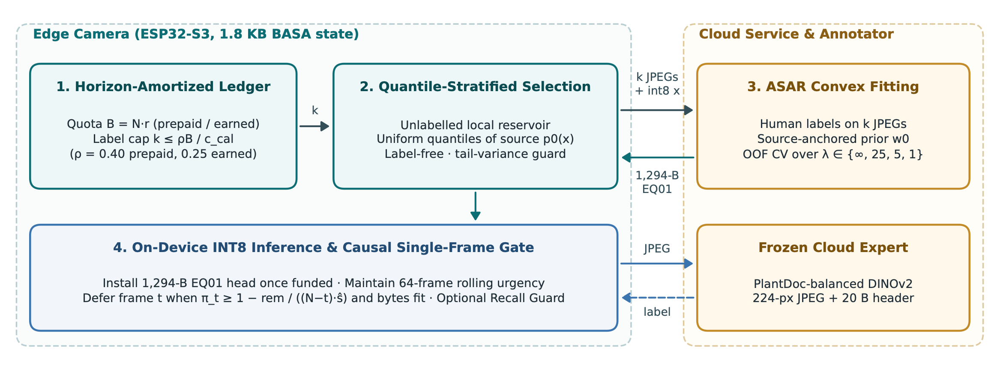
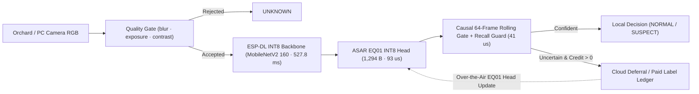
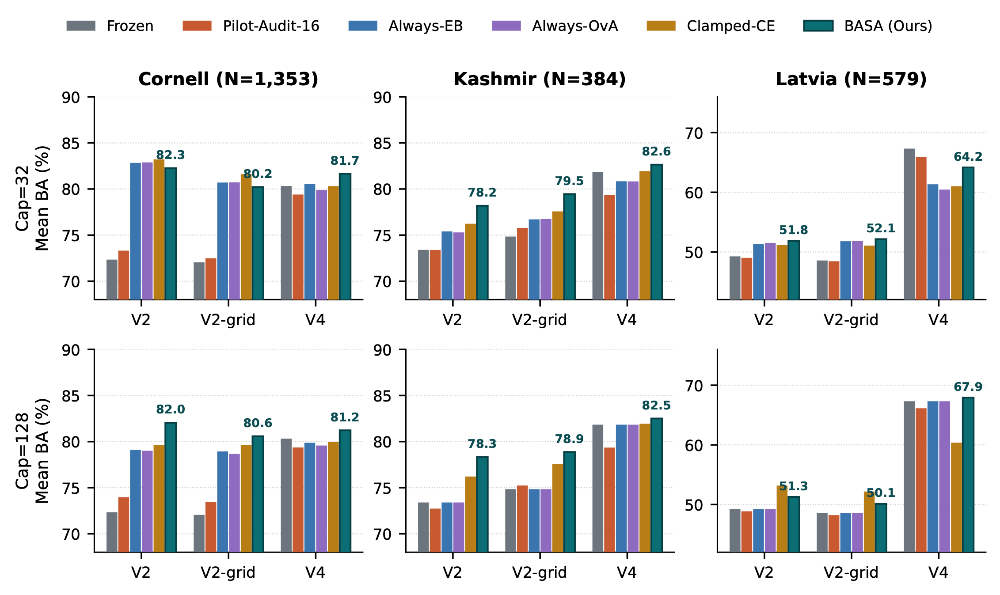
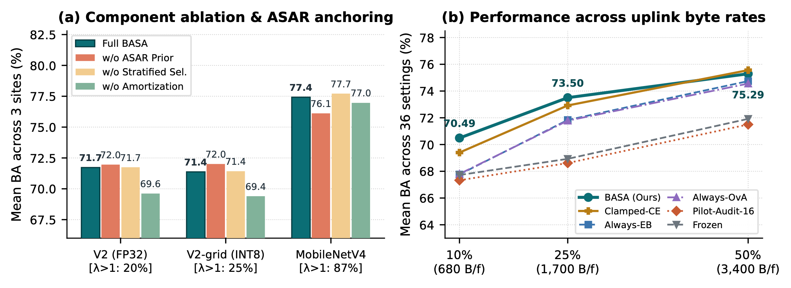
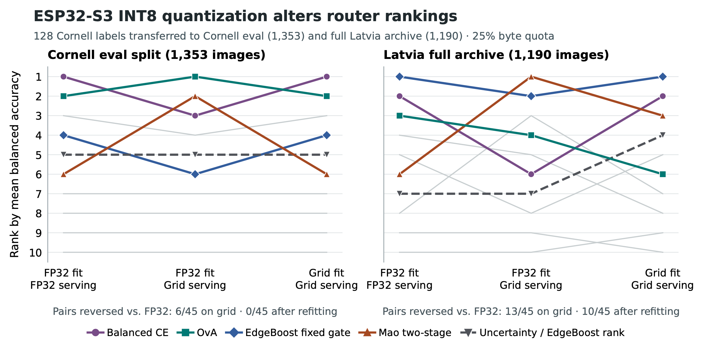
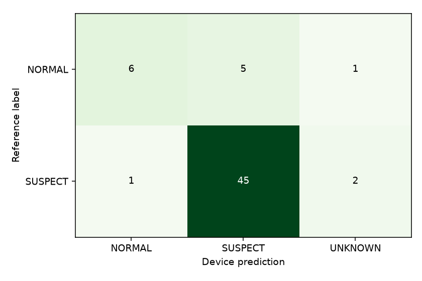
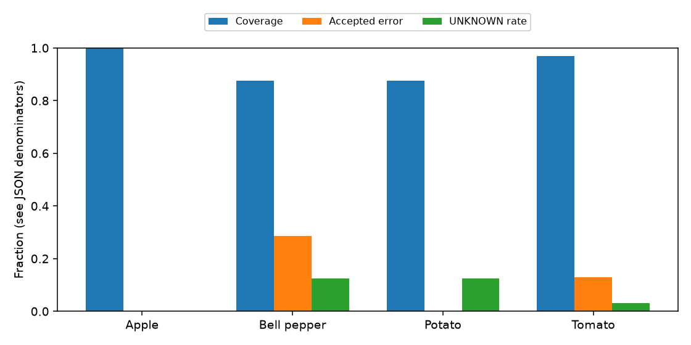

# AgriTinyVision

**English** | [简体中文](README.zh-CN.md)

**TinyML crop disease screening, ESP32-S3 INT8 deployment, and budget-amortized source-anchored edge adaptation (`BASA`) for bandwidth-limited orchard cameras.**

AgriTinyVision combines an end-to-end embedded vision pipeline for **ESP32-S3 N16R8** (`MobileNetV2 160×160 INT8`, quality gating, three-state `NORMAL` / `SUSPECT` / `UNKNOWN` screening, SHA256-verified USB Web console, and controlled quantization probes) with **`BASA` (Budget-Amortized Source-Anchored Adaptation)**—a unified byte-ledger framework and zero-allocation C99 runtime that trades off paid remote orchard annotations against strictly causal single-frame cloud deferral under microcontroller INT8 quantization.

[Overview](#overview) · [Architecture](#system-architecture) · [BASA Results](#1-basa-budget-amortized-adaptation--int8-quantization-audit) · [ESP32-S3 Hardware](#2-esp32-s3-silicon-benchmark--pc-camera-web-console) · [Field Validation](#3-external-field-validation--v03-reliability-probes) · [Quick Start](#quick-start) · [COMPAG Paper (PDF)](research/field-edge-audit/paper/manuscript_compag.pdf)

---

## Overview

Deploying low-power orchard cameras for foliar disease screening confronts two coupled constraints: severe cross-orchard visual domain shift and tight wireless uplink quotas. Under a fixed communication allowance, a field camera must decide whether to spend uplink bytes uploading a small batch of orchard photographs for remote agronomic annotation (to fit a new local classifier head) or keep its factory head frozen and defer uncertain frames to a cloud vision model.

Across **three decontaminated apple-leaf cohorts** (Cornell, Kashmir, and date-split Latvia), **three edge pipelines** (MobileNetV2 FP32, ESP32-S3 host INT8 replay, and MobileNetV4-Conv-Small), **16 baseline methods** (13 fixed-cap + 3 budget-clamped), and **direct ESP32-S3 N16R8 silicon execution**, AgriTinyVision delivers:

- **Budget-Amortized Source-Anchored Adaptation (`BASA`):** Couples horizon-amortized supervision budgeting, label-free quantile-stratified selection, convex Anisotropic Source-Anchored Regularization (**ASAR**) packed into a **1,294-byte `EQ01` INT8 head**, and a causal 64-frame rolling-percentile deferral gate. Achieves the highest mean balanced accuracy across all **36 primary 25%-uplink settings** (**73.50%** overall; **74.49%** prepaid; **72.52%** earned), beating 13 fixed-cap baselines by **+1.46 to +5.35 pp** and 3 budget-clamped baselines by **+0.58 to +0.89 pp** (**+1.14 to +1.36 pp** under earned credit).
- **Scarce-uplink dominance & honest abundant-uplink boundary:** Leads at a tight **10% uplink** (**70.49%** vs. **69.40%** for `Clamped-CE`) while transparently reporting the **50% abundant-uplink crossover**, where `Clamped-CE` slightly edges ahead (**75.56%** vs. **75.29%**).
- **Microcontroller INT8 quantization audit & on-chip ESP32-S3 silicon runtime:** Demonstrates that ESP32-S3 INT8 quantization reverses up to **13/45** pairwise router rankings relative to FP32. On physical **ESP32-S3 N16R8** (160 MHz, ESP-IDF v5.4.4 / ESP-DL v3.3.13), the frozen MobileNetV2 160 INT8 backbone runs in **527.84 ms** (P50) with **500/500** sustained frames and zero restarts, while BASA's standalone C99 runtime adds only **93 µs** head inference + **41 µs** gating (**0.025%** of backbone latency), **1,836 B** persistent RAM (**0.64%** free SRAM), **0 B** PSRAM growth, and **0/16** bit-level mismatches (`0/81,180` on host C99).
- **v0.3 SHA256-verified PC camera Web console & external field audit:** Verifies connected device model/deployment SHA256, tensor exponents, and decision bounds before streaming frames, supports lossless field photo collection/annotation, and evaluates a 60-image external PlantDoc subset (**88.33%** binary accuracy, **95.00%** accepted coverage, **89.47%** accepted accuracy).



---

## System Architecture



1. **Quality gate & three-state screening (`agritinyvision/` + `firmware_example/`):** Filters unreadable, blurred, or poorly exposed frames before inference (`Quality` failures always return `UNKNOWN`). Trained binary classes (`NORMAL`, `SUSPECT`) apply frozen validation bounds (`0.20` / `0.40` around threshold `0.30`) so ambiguous predictions fall safely into `UNKNOWN`.
2. **Quantized ESP-DL backbone (`PyTorch → ONNX → ESP-PPQ → ESP-DL`):** MobileNetV2 160×160 INT8 (`w8a8`, 2.44 MB `.espdl`) runs deterministically on ESP32-S3 N16R8 with SHA256 identity checking and controlled FP32-vs-device probe auditing (`v0.3`).
3. **Unified byte ledger & ASAR head adaptation (`research/field-edge-audit/`):** Accounts for both paid remote orchard annotation uploads and deferred cloud-review frames on a single byte ledger under **prepaid** (upfront) and **earned** (zero-initial-credit) funding schedules. Convex **ASAR** anchors small-sample target updates to the factory classifier direction, preventing MobileNetV4 collapse under cross-orchard shift and packing the adapted head into a **1,294-byte `EQ01`** INT8 packet.
4. **Causal streaming deferral & standalone C99 runtime (`c_reference/` + `esp32s3_bench/`):** Routes each frame strictly causally via a 64-frame rolling-percentile score gate with an optional one-sided recall guard, audited for bit-exact parity between Python, host C99, and ESP32-S3 N16R8 silicon.

[COMPAG Manuscript (PDF)](research/field-edge-audit/paper/manuscript_compag.pdf) · [Research Artifact Guide](research/field-edge-audit/README.md) · [Integration Contract](docs/INTEGRATION_CONTRACT.md) · [USB Protocol](docs/USB_PROTOCOL.md)

---

## Experimental Results

### 1. BASA: Budget-Amortized Adaptation & INT8 Quantization Audit

Evaluated across **36 primary 25%-uplink settings** (3 orchards: Cornell, Kashmir, date-split Latvia × 3 pipelines: MobileNetV2 FP32, V2 ESP32-S3 host INT8 replay, MobileNetV4-Conv-Small × 2 budgets × 2 funding schedules) against 13 fixed-cap baselines and 3 budget-clamped baselines:

| Method Family | Policy | Overall 36-Setting Bal. Acc. (%) ↑ | Prepaid (%) ↑ | Earned Credit (%) ↑ | 10% Scarce Uplink (%) ↑ | 50% Abundant Uplink (%) ↑ |
| :--- | :--- | :---: | :---: | :---: | :---: | :---: |
| **Frozen / No Adapt** | Always-Defer / Frozen Gate | 68.15 – 71.12 | — | — | — | — |
| **Fixed-Cap (13 Baselines)** | Best Fixed-Cap (`Fixed-CE` / `OvA` / `EB-rank`) | 68.15 – 72.04 | — | — | — | — |
| **Budget-Clamped** | `Clamped-OvA` | 72.61 | 73.85 | 71.38 | — | — |
| **Budget-Clamped** | `Clamped-EB-rank` | 72.73 | 74.16 | 71.30 | — | — |
| **Budget-Clamped** | `Clamped-CE` | 72.92 | 74.68 | 71.16 | 69.40 | **75.56** *(boundary)* |
| **Proposed (Ours)** | **`BASA` (ASAR + Causal Gate)** | **73.50** | **74.49** | **72.52** | **70.49** | 75.29 |







- **Earned-credit & scarce-uplink resilience:** When uplink credit accrues incrementally without upfront borrowing (`earned`), capping paid supervision prevents prolonged unadapted startup delays, lifting `BASA` by **+1.14 to +1.36 pp** over all three budget-clamped baselines.
- **Why ASAR matters on modern backbones:** Unanchored cross-entropy fine-tuning collapses on shifted orchards under small label counts (`MobileNetV4`), whereas convex anisotropic source anchoring preserves pretrained ordering automatically when $k$ is small and relaxes toward full linear adaptation on weaker source heads (`MobileNetV2`).
- **Quantization alters router rankings:** Running identical cohorts through ESP32-S3 INT8 quantization reverses up to **13/45** pairwise deferral-router rankings relative to FP32, confirming that edge routing should be selected on quantized activations rather than desktop FP32 scores.

[BASA Results Tables](research/field-edge-audit/results/basa/) · [Clamped Baseline Audit](research/field-edge-audit/scripts/clamped_baselines.py) · [ESP32-S3 C99 Bench](research/field-edge-audit/esp32s3_bench/)

---

### 2. ESP32-S3 Silicon Benchmark & PC Camera Web Console

Direct physical hardware measurements on **ESP32-S3 N16R8** (160 MHz, 16 MB Flash, 8 MB PSRAM, ESP-IDF v5.4.4, ESP-DL v3.3.13) alongside PlantVillage FP32/INT8 baseline validation:

| Component / Hardware Metric | Measured Value | Notes |
| :--- | :--- | :--- |
| **MobileNetV2 160 INT8 Backbone (ESP-DL)** | **527.84 ms** (P50) / **527.85 ms** (P95) | 2.44 MB `.espdl`; 3.57 MB app image; **500/500** frames in 536.46 s (0 restarts) |
| **Free Memory on ESP32-S3 N16R8** | **286,447 B** SRAM / **5,046,852 B** PSRAM | Measured with live camera/inference firmware (`v0.2` / `v0.3`) |
| **BASA Wire Head Packet (`EQ01`)** | **1,294 B** | Over-the-air INT8 head update |
| **BASA Persistent State (`head` + `gate`)** | **1,836 B** (`1,292 B` + `544 B`) | **0.64%** free SRAM; **0 B** PSRAM delta (`8,386,188 B` unchanged) |
| **BASA On-Chip `EQ01` Parse / Inference** | **50 µs** / **93 µs** (P50) | **0.018%** of backbone latency (1,000 runs) |
| **BASA On-Chip Streaming Gate / Quant.** | **41 µs** / **565 µs** (P50) | Combined per-frame overhead **134 µs** (**0.025%** backbone) |
| **Bit-Exact Parity (ESP32-S3 / Host C99)** | **0 / 16** (`0.0` err) / **0 / 81,180** (`< 1e-12`) | Zero mismatch against Python reference |

| PlantVillage Controlled Subset (2,792 images, 12 labels) | Test Accuracy | `SUSPECT` Recall | FNR | Artifact |
| :--- | :---: | :---: | :---: | :--- |
| MobileNetV2 160 FP32 | 99.76% | 100.00% | 0.00% | 8.88 MB ONNX |
| MobileNetV2 160 INT8 (selected candidate) | 99.52% | 99.65% | 0.35% | 2.44 MB ESP-DL (host simulation) |
| MobileNetV2 224 FP32 | 100.00% | 100.00% | 0.00% | 8.88 MB ONNX |
| MobileNetV2 224 INT8 | 100.00% | 100.00% | 0.00% | 2.51 MB ESP-DL (host simulation) |

[Hardware v0.2 Report](reports/HARDWARE_V02.md) · [First-Run Report](reports/FIRST_RUN.md) · [Quantization Analysis v0.3](reports/QUANTIZATION_ANALYSIS_V03.md)

---

### 3. External Field Validation & v0.3 Reliability Probes

A local Web console (`http://127.0.0.1:8765` and `/field` annotation workspace) enforces strict model/deployment SHA256 verification before streaming USB frames. On an initial **60-image external PlantDoc test subset** (dataset-author labels), the frozen ESP32-S3 model achieves **88.33%** binary accuracy, **95.00%** accepted coverage, **89.47%** accepted accuracy (`UNKNOWN` 3/60, normal-reference false alarms 5/12). Across ten controlled v0.3 deployment probes (lighting, contrast, blur, color shift, non-plant, noise), 9/10 gated states agree between ONNX FP32 and physical ESP32-S3.





[Field Validation Guide](docs/FIELD_VALIDATION.md) · [Field Results](docs/FIELD_VALIDATION_RESULTS.md) · [v0.3 Reliability Guide](docs/V03_RELIABILITY.md) · [v0.3 Validation Matrix](docs/V03_VALIDATION.md)

---

## Quick Start

Requires **Python 3.10+** (Windows 11 or Linux). For physical device workflows: **ESP32-S3 N16R8**, USB data cable, **ESP-IDF 5.4.4**, and **ESP-DL 3.3.13**.

**1. Verify BASA experiments, clamped baselines, and C99 runtime**

```bash
cd research/field-edge-audit
python3 -m pip install -r requirements.txt
python3 -m pytest -q
python3 scripts/clamped_baselines.py
python3 scripts/basa_tail_risk_audit.py
```

**2. Run the SHA256-verified ESP32-S3 PC Camera Web Console (Windows PowerShell)**

```powershell
python -m pip install -e '.[camera,web,dev]'
python scripts/run_pc_camera.py --list-ports
python scripts/prepare_camera_firmware.py --bundle releases/v0.1.0
# In ESP-IDF 5.4.4 PowerShell:
.\scripts\build_firmware.ps1 -Mode Camera -Transport USBJTAG
python "$env:IDF_PATH\tools\idf.py" -C firmware_example -B "$PWD\build-camera" -p COM3 flash
# Start Web console (opens http://127.0.0.1:8765):
python scripts/run_pc_camera.py --port COM3 --camera 0 --fps 1
```

**3. Reproduce PlantVillage training, ONNX export & ESP-DL INT8 quantization**

```bash
python -m venv .venv && source .venv/bin/activate
python -m pip install -e '.[dev]' esp-ppq
python scripts/download_plantvillage.py
python -m agritinyvision prepare-data && python -m agritinyvision audit
python -m agritinyvision train --config configs/train_mobilenetv2_160.yaml --output runs/baseline160
python -m agritinyvision evaluate --checkpoint runs/baseline160/best.pt
python -m agritinyvision export --checkpoint runs/baseline160/best.pt --format onnx
python -m agritinyvision quantize --checkpoint runs/baseline160/best.pt --model runs/baseline160/tinyvision.onnx
```

**4. Run v0.3 controlled FP32-vs-ESP32 comparison & regression tests**

```powershell
python scripts/prepare_analysis_scenes.py --image PATH_TO_LEAF --source DATASET_ID --label NORMAL --split train --output runs/v03/my-scenes
python scripts/quantization_analysis.py --manifest runs/v03/my-scenes/manifest.json --bundle releases/v0.1.0 --port COM3 --output runs/v03/my-comparison
python -m pytest -q --strict-markers
```

[Windows PC Camera Setup](docs/PC_CAMERA_SETUP.md) · [Hardware Deployment Guide](docs/HARDWARE_DEPLOYMENT.md) · [Firmware README](firmware_example/README.md)

---

## Repository Layout

| Directory | Contents |
| :--- | :--- |
| `agritinyvision/` | Core Python package: dataset preparation, MobileNetV2 training, ONNX export, ESP-PPQ quantization, Web console & USB client |
| `firmware_example/` | ESP-IDF 5.4.4 / ESP-DL 3.3.13 ESP32-S3 firmware (fixture, USB Serial/JTAG, UART camera inference, quality gate) |
| `research/field-edge-audit/` | **BASA** paper (`manuscript_compag.tex`/`.pdf`), unified byte-ledger simulators, clamped/tail-risk audits, C99 reference (`c_reference/`), and on-chip ESP32-S3 benchmark firmware (`esp32s3_bench/`) |
| `configs/`, `data/` | Label mapping (`label_mapping.yaml`), training configs (`160×160` / `224×224`), manifest & split audit rules |
| `scripts/`, `tests/` | End-to-end CLI tools, v0.3 quantization probe scripts, and software/hardware regression test suites |
| `docs/`, `reports/` | Integration contract, USB protocol, v0.2/v0.3 validation reports, and PlantDoc field validation summaries |

---

## Scope & Limitations

- **Emulated cross-orchard replay vs. live radio energy:** While BASA's `EQ01` head, quantization kernel, and streaming gate ran directly on ESP32-S3 N16R8 silicon (`134 µs`, `0/16` parity), the 3,000+ cross-site V2-grid activations rely on host ESP-PPQ replay, and external-instrument board power draw during live cellular/LoRa transmission remains open.
- **Honest abundant-uplink crossover:** At a generous 50% uplink quota, budget-clamped cross-entropy (`Clamped-CE`) slightly outperforms `BASA` (**75.56%** vs. **75.29%**), establishing BASA's primary advantage at scarce-to-moderate uplinks (10–25%) and earned-credit schedules.
- **Controlled vs. independent field labels:** PlantVillage scores reflect controlled backgrounds; the 60-image PlantDoc subset uses dataset-author labels, and independent human-reviewed multi-orchard field splits remain ongoing. Quality gates check blur, brightness, and contrast rather than full out-of-distribution plant detection.
- **System boundary with `Smart-Agriculture-Edge-AI`:** AgriTinyVision is the vision edge module targeting future integration into [Smart-Agriculture-Edge-AI](https://github.com/Sver0411/Smart-Agriculture-Edge-AI); physical closed-loop gateway actuation and LoRa failover live in separate repositories below.

---

## License & Related Research Stack

Project code and documentation are released under the [MIT License](LICENSE). External datasets (PlantVillage, PlantDoc, Cornell, Kashmir, Latvia) and pretrained weights remain subject to their original licenses.

`AgriTinyVision` belongs to **L4 · Resilience & CPS Validation** of a reproducible 4-layer AIoT systems stack:

- **L1 · Reliable Sensing:** [SensorTrust](https://github.com/Sver0411/SensorTrust)
- **L2 · Adaptive Observation:** [AdaptiveSense](https://github.com/Sver0411/AdaptiveSense) · [TAIS](https://github.com/Sver0411/TAIS)
- **L3 · Freshness & Lossy Links:** [EventGuard-LoRa](https://github.com/Sver0411/EventGuard-LoRa) · [NetAdapt-IoT](https://github.com/Sver0411/NetAdapt-IoT) · [IoT-MPQUIC-Scheduler](https://github.com/Sver0411/IoT-MPQUIC-Scheduler)
- **L4 · Resilience & CPS Validation:** [EdgeFaultLab](https://github.com/Sver0411/EdgeFaultLab) · [TinyEdgeBench](https://github.com/Sver0411/TinyEdgeBench) · [Smart-Agriculture-Edge-AI](https://github.com/Sver0411/Smart-Agriculture-Edge-AI) · [AgriTwin-CPS](https://github.com/Sver0411/AgriTwin-CPS) · [AgriTinyVision](https://github.com/Sver0411/AgriTinyVision)
