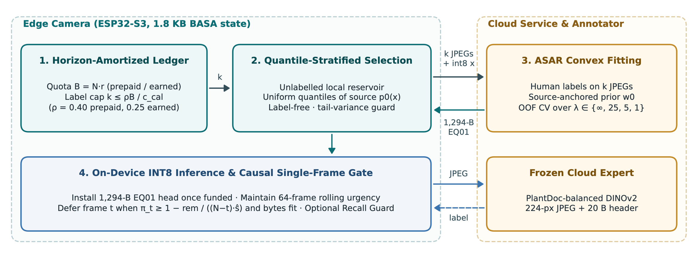
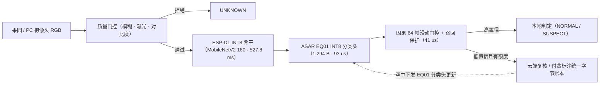
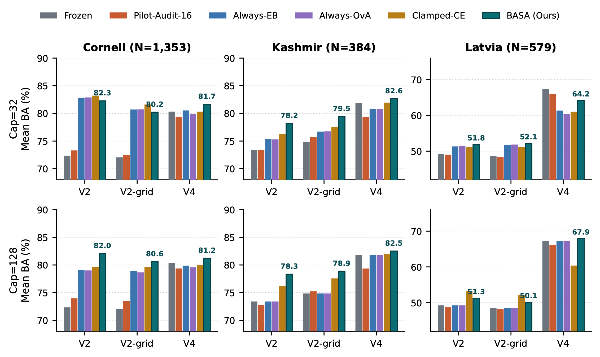
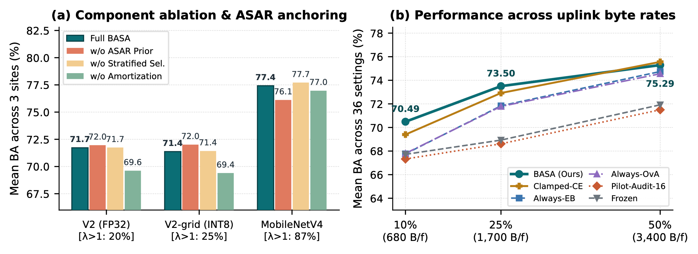
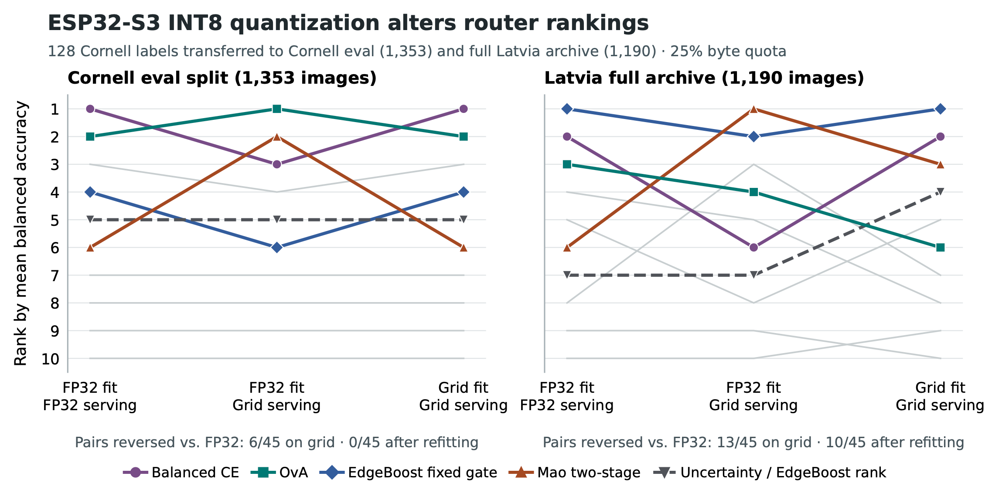
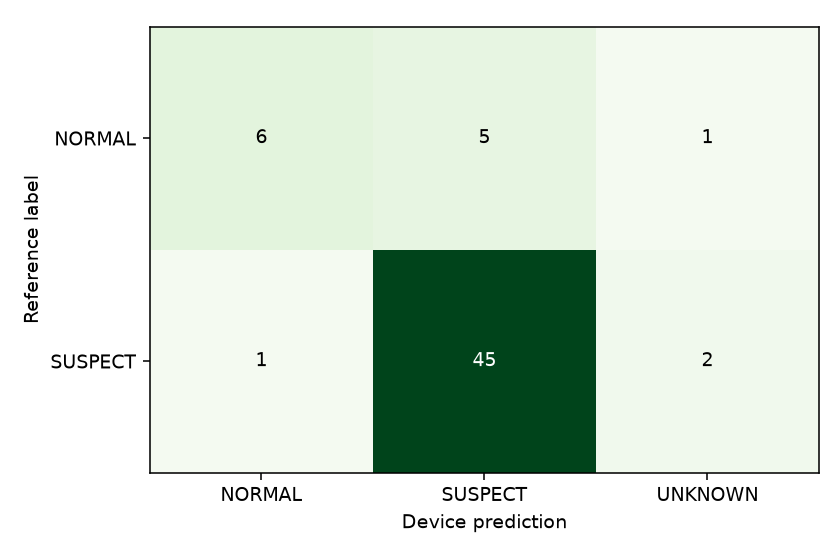
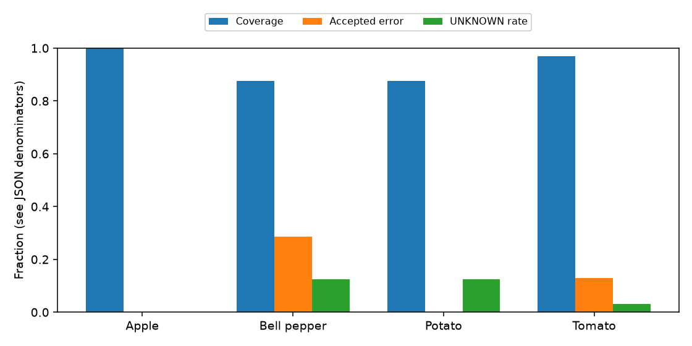

# AgriTinyVision

[English](README.md) | **简体中文**

**面向带宽受限果园相机的 TinyML 作物病害初筛、ESP32-S3 INT8 实机部署与预算摊销源锚定边缘自适应框架（`BASA`）。**

AgriTinyVision 将 **ESP32-S3 N16R8** 端到端嵌入式视觉链路（`MobileNetV2 160×160 INT8`、图像质量门控、`NORMAL` / `SUSPECT` / `UNKNOWN` 三态初筛、SHA256 强校验 USB Web 控制台与受控量化探针）与 **`BASA`（Budget-Amortized Source-Anchored Adaptation）** 统一于同一仓库——在同一字节账本下严格权衡“付费远程农学标注适配本地分类头”与“严格因果单帧云端延后复核”，并提供零堆分配 C99 实机运行时。

[项目概览](#项目概览) · [系统架构](#系统架构) · [BASA 实验结果](#1-basa预算摊销源锚定自适应与-int8-量化审计) · [ESP32-S3 实机数据](#2-esp32-s3-实机基准与-pc-摄像头-web-控制台) · [外部田间验证](#3-外部田间验证与-v03-可靠性探针) · [快速开始](#快速开始) · [COMPAG 论文 (PDF)](research/field-edge-audit/paper/manuscript_compag.pdf)

---

## 项目概览

低功耗果园相机在开展叶片病害巡检时同时面临两个耦合瓶颈：**严重的跨果园视觉域漂移**与**极紧的无线上传带宽配额**。在固定通信预算下，端侧相机必须抉择：是花一部分上行字节上传少量本地果园照片购买远程标注以重训轻量分类头，还是冻结出厂分类头、把不确定帧逐帧上传给云端大模型复核？

在 **3 组去污染跨果园苹果叶片数据集**（Cornell、Kashmir 与按日期划分的 Latvia）、**3 条边缘推理管线**（MobileNetV2 FP32、ESP32-S3 主机 INT8 仿真回放、MobileNetV4-Conv-Small）、**16 种基线方法**（13 种固定上限基线 + 3 种同预算截断基线）以及 **ESP32-S3 N16R8 实机芯片实测**上，AgriTinyVision 实现了：

- **预算摊销源锚定自适应（`BASA`）：** 将视界摊销标注预算、无标签分位数分层选样、凸**各向异性源锚定正则（ASAR）**打包为 **1,294 B `EQ01` INT8 分类头**，并配合因果 64 帧滑动分位门控。在全部 **36 组主测试（25% 上行配额）** 中取得全场最高均值平衡准确率（总计 **73.50%**；预拨额度 **74.49%**；零初始赚取额度 **72.52%**），领先 13 种固定上限基线 **+1.46 至 +5.35 pp**，领先 3 种同预算截断基线 **+0.58 至 +0.89 pp**（零初始赚取额度下领先 **+1.14 至 +1.36 pp**）。
- **稀缺带宽领先与诚实高带宽边界：** 在紧缺的 **10% 上行配额** 下依然稳居第一（**70.49%** vs. `Clamped-CE` **69.40%**），同时诚实披露在宽松的 **50% 上行配额** 下的交叉边界（`Clamped-CE` 以 **75.56%** 略高于 `BASA` 的 **75.29%**）。
- **微控制器 INT8 量化审计与 ESP32-S3 实机运行：** 实证 ESP32-S3 INT8 量化相对 FP32 会导致多达 **13/45** 组路由器两两排名翻转；在物理 **ESP32-S3 N16R8**（160 MHz，ESP-IDF v5.4.4 / ESP-DL v3.3.13）上，冻结 MobileNetV2 160 INT8 骨干实测 **527.84 ms**（P50）且连续运行 **500/500 帧无重启**，而 BASA 独立 C99 运行时仅增加 **93 µs** 分类头推理 + **41 µs** 流式门控（仅占骨干耗时 **0.025%**）、**1,836 B** 常驻 RAM（占空闲 SRAM **0.64%**）、**0 B** PSRAM 增量，芯片实机 bit 级一致性 **0/16 误差**（主机全队列 **0/81,180**）。
- **v0.3 SHA256 强校验 PC 摄像头控制台与外部验证：** 发送图像前强制校验板端模型/部署 SHA256、张量 exponent 与决策边界；支持无损田间采集标注；在 60 张外部 PlantDoc 测试子集上达到 **88.33%** 二分类准确率、**95.00%** 接受覆盖率与 **89.47%** 接受准确率。



---

## 系统架构



1. **质量门控与三态初筛（`agritinyvision/` + `firmware_example/`）：** 推理前拦截模糊、过曝或低对比度帧（质量不达标强制输出 `UNKNOWN`）；仅训练 `NORMAL` 与 `SUSPECT` 两类，围绕验证集冻结阈值 `0.30` 导出 `0.20 / 0.40` 区间，中间不确定带安全落入 `UNKNOWN`。
2. **量化 ESP-DL 骨干（`PyTorch → ONNX → ESP-PPQ → ESP-DL`）：** MobileNetV2 160×160 INT8（`w8a8`，2.44 MB `.espdl`）在 ESP32-S3 N16R8 确定性执行，并支持 v0.3 SHA256 身份核验与受控 FP32/实机对比探针。
3. **统一字节账本与 ASAR 分类头适配（`research/field-edge-audit/`）：** 在**预拨额度（prepaid）**与**零初始赚取额度（earned）**两种体制下统一核算付费标注与云端复核字节；凸 **ASAR** 将小样本适配锚定到出厂分类方向，防止 MobileNetV4 在跨果园漂移下崩塌，并将更新头压缩至 **1,294 字节 `EQ01`** INT8 包。
4. **因果流式延后复核与独立 C99 运行时（`c_reference/` + `esp32s3_bench/`）：** 基于 64 帧滑动分位数和可选单侧召回保护完成零前瞻逐帧路由，Python、主机 C99 与 ESP32-S3 芯片实机逐位对齐。

[COMPAG 论文 (PDF)](research/field-edge-audit/paper/manuscript_compag.pdf) · [研究目录与复现指南](research/field-edge-audit/README.md) · [集成契约](docs/INTEGRATION_CONTRACT.md) · [USB 协议](docs/USB_PROTOCOL.md)

---

## 实验结果

### 1. BASA：预算摊销源锚定自适应与 INT8 量化审计

在 **36 组主测试（25% 上行配额）**（3 果园 × 3 管线 × 2 预算尺度 × 2 资助体制）上对比 13 种固定上限基线与 3 种同预算截断基线：

| 方法类别 | 策略 | 36 组均值平衡准确率 (%) ↑ | 预拨额度 (%) ↑ | 零初始赚取额度 (%) ↑ | 10% 稀缺带宽 (%) ↑ | 50% 宽松带宽 (%) ↑ |
| :--- | :--- | :---: | :---: | :---: | :---: | :---: |
| **冻结不适配** | 始终复核 / 冻结门控 | 68.15 – 71.12 | — | — | — | — |
| **固定上限（13 种）** | 最优固定上限基线 | 68.15 – 72.04 | — | — | — | — |
| **同预算截断** | `Clamped-OvA` | 72.61 | 73.85 | 71.38 | — | — |
| **同预算截断** | `Clamped-EB-rank` | 72.73 | 74.16 | 71.30 | — | — |
| **同预算截断** | `Clamped-CE` | 72.92 | 74.68 | 71.16 | 69.40 | **75.56** *(高带宽边界)* |
| **本文方法** | **`BASA`（ASAR + 因果门控）** | **73.50** | **74.49** | **72.52** | **70.49** | 75.29 |







- **零初始额度与稀缺带宽优势：** 在无预借额度的 `earned` 场景下，限制标注开销占比可避免漫长的未适配冷启动期，使 `BASA` 领先全部 3 种同预算截断基线 **+1.14 至 +1.36 pp**。
- **ASAR 防止现代骨干崩塌：** 小样本下无锚定交叉熵微调易导致 `MobileNetV4` 在漂移果园崩塌，而凸各向异性源锚定在样本少时自动保护预训练排序、在弱源头（`MobileNetV2`）上平滑释放线性适配能力。
- **量化会改变路由选型：** 在 ESP32-S3 INT8 激活上评估同一果园队列时，多达 **13/45** 组路由器两两排名相对 FP32 发生翻转，说明边缘路由器选型必须在量化精度下验证。

[BASA 汇总结果表](research/field-edge-audit/results/basa/) · [同预算截断基线脚本](research/field-edge-audit/scripts/clamped_baselines.py) · [ESP32-S3 C99 实机基准](research/field-edge-audit/esp32s3_bench/)

---

### 2. ESP32-S3 实机基准与 PC 摄像头 Web 控制台

**ESP32-S3 N16R8**（160 MHz，16 MB Flash，8 MB PSRAM，ESP-IDF v5.4.4，ESP-DL v3.3.13）真实芯片测量与 PlantVillage 基线：

| 模块 / 硬件指标 | 实测数值 | 说明 |
| :--- | :--- | :--- |
| **MobileNetV2 160 INT8 骨干（ESP-DL）** | **527.84 ms** (P50) / **527.85 ms** (P95) | 2.44 MB `.espdl`；3.57 MB app 镜像；**500/500 帧**连续运行 536.46 秒无重启 |
| **ESP32-S3 N16R8 空闲内存** | **286,447 B** SRAM / **5,046,852 B** PSRAM | 实机相机推理固件测量（`v0.2` / `v0.3`） |
| **BASA 空中分类头数据包（`EQ01`）** | **1,294 B** | 轻量 OTA INT8 分类头更新包 |
| **BASA 常驻内存（`head` + `gate`）** | **1,836 B**（`1,292 B` + `544 B`） | 占空闲 SRAM **0.64%**；PSRAM 增量 **0 B**（`8,386,188 B` 不变） |
| **BASA 片上 `EQ01` 解析 / 推理** | **50 µs** / **93 µs** (P50) | 仅占骨干耗时 **0.018%**（1,000 次实测） |
| **BASA 片上流式门控 / 量化** | **41 µs** / **565 µs** (P50) | 单帧合并额外开销 **134 µs**（占骨干 **0.025%**） |
| **Bit 级一致性（ESP32-S3 / 主机 C99）** | **0 / 16**（`0.0` 误差）/ **0 / 81,180**（`< 1e-12`） | 与 Python 参考实现零偏差 |

| PlantVillage 受控子集（2,792 图，12 源标签） | 测试准确率 | `SUSPECT` 召回率 | 漏报率 FNR | 产物 |
| :--- | :---: | :---: | :---: | :--- |
| MobileNetV2 160 FP32 | 99.76% | 100.00% | 0.00% | 8.88 MB ONNX |
| MobileNetV2 160 INT8（冻结选型） | 99.52% | 99.65% | 0.35% | 2.44 MB ESP-DL（主机仿真） |
| MobileNetV2 224 FP32 | 100.00% | 100.00% | 0.00% | 8.88 MB ONNX |
| MobileNetV2 224 INT8 | 100.00% | 100.00% | 0.00% | 2.51 MB ESP-DL（主机仿真） |

[v0.2 实机硬件报告](reports/HARDWARE_V02.md) · [首次运行报告](reports/FIRST_RUN.md) · [v0.3 量化对比分析](reports/QUANTIZATION_ANALYSIS_V03.md)

---

### 3. 外部田间验证与 v0.3 可靠性探针

本地 Web 控制台（`http://127.0.0.1:8765` 与 `/field` 标注工作台）在发送首帧前强制校验设备模型与部署 SHA256。在首轮 **60 张外部 PlantDoc 测试子集**（来源标注）上，冻结 ESP32-S3 模型取得 **88.33%** 二分类准确率、**95.00%** 接受覆盖率与 **89.47%** 接受准确率（`UNKNOWN` 3/60，正常参考误报 5/12）。在 10 类受控部署探针（光照、对比度、模糊、色彩偏移、非植物与噪声）中，ONNX FP32 与 ESP32-S3 实机在 9/10 组门控状态上完全一致。





[田间验证操作指南](docs/FIELD_VALIDATION.md) · [实测结果](docs/FIELD_VALIDATION_RESULTS.md) · [v0.3 可靠性指南](docs/V03_RELIABILITY.md) · [v0.3 验收矩阵](docs/V03_VALIDATION.md)

---

## 快速开始

需要 **Python 3.10+**（Windows 11 或 Linux）；硬件链路需 **ESP32-S3 N16R8**、USB 数据线、**ESP-IDF 5.4.4** 与 **ESP-DL 3.3.13**。

**1. 复现 BASA 实验、同预算基线与 C99 一致性测试**

```bash
cd research/field-edge-audit
python3 -m pip install -r requirements.txt
python3 -m pytest -q
python3 scripts/clamped_baselines.py
python3 scripts/basa_tail_risk_audit.py
```

**2. 启动 SHA256 强校验 ESP32-S3 PC 摄像头 Web 控制台（Windows PowerShell）**

```powershell
python -m pip install -e '.[camera,web,dev]'
python scripts/run_pc_camera.py --list-ports
python scripts/prepare_camera_firmware.py --bundle releases/v0.1.0
# 在 ESP-IDF 5.4.4 PowerShell 中编译并烧录：
.\scripts\build_firmware.ps1 -Mode Camera -Transport USBJTAG
python "$env:IDF_PATH\tools\idf.py" -C firmware_example -B "$PWD\build-camera" -p COM3 flash
# 启动 Web 控制台（自动打开 http://127.0.0.1:8765）：
python scripts/run_pc_camera.py --port COM3 --camera 0 --fps 1
```

**3. 复现 PlantVillage 训练、ONNX 导出与 ESP-DL INT8 量化**

```bash
python -m venv .venv && source .venv/bin/activate
python -m pip install -e '.[dev]' esp-ppq
python scripts/download_plantvillage.py
python -m agritinyvision prepare-data && python -m agritinyvision audit
python -m agritinyvision train --config configs/train_mobilenetv2_160.yaml --output runs/baseline160
python -m agritinyvision evaluate --checkpoint runs/baseline160/best.pt
python -m agritinyvision export --checkpoint runs/baseline160/best.pt --format onnx
python -m agritinyvision quantize --checkpoint runs/baseline160/best.pt --model runs/baseline160/tinyvision.onnx
```

**4. 运行 v0.3 受控 FP32 与 ESP32 对照探针及回归测试**

```powershell
python scripts/prepare_analysis_scenes.py --image PATH_TO_LEAF --source DATASET_ID --label NORMAL --split train --output runs/v03/my-scenes
python scripts/quantization_analysis.py --manifest runs/v03/my-scenes/manifest.json --bundle releases/v0.1.0 --port COM3 --output runs/v03/my-comparison
python -m pytest -q --strict-markers
```

[Windows 摄像头配置](docs/PC_CAMERA_SETUP.md) · [硬件部署文档](docs/HARDWARE_DEPLOYMENT.md) · [固件说明](firmware_example/README.md)

---

## 仓库目录

| 目录 | 说明 |
| :--- | :--- |
| `agritinyvision/` | 核心 Python 包：数据准备、MobileNetV2 训练、ONNX 导出、ESP-PPQ 量化、Web 控制台与 USB 通信客户端 |
| `firmware_example/` | ESP-IDF 5.4.4 / ESP-DL 3.3.13 ESP32-S3 固件（Fixture、USB Serial/JTAG、UART 推理与质量门控） |
| `research/field-edge-audit/` | **BASA** 论文（`manuscript_compag.tex`/`.pdf`）、统一字节账本仿真器、截断与尾风险审计、C99 参考实现（`c_reference/`）及 ESP32-S3 片上基准固件（`esp32s3_bench/`） |
| `configs/`, `data/` | 标签映射（`label_mapping.yaml`）、训练配置（`160×160` / `224×224`）及数据划分审计规范 |
| `scripts/`, `tests/` | CLI 工具、v0.3 量化探针脚本与软硬件回归测试套件 |
| `docs/`, `reports/` | 集成契约、USB 协议、v0.2/v0.3 实机验收报告及 PlantDoc 外部田间验证汇总 |

---

## 范围与局限性

- **主机仿真与整机射频功耗：** BASA 的 `EQ01` 分类头、量化内核与流式门控已在 ESP32-S3 N16R8 物理芯片上实测验证（`134 µs`，`0/16` 零误差），但 3,000+ 跨果园 V2 特征网格仍基于主机 ESP-PPQ 仿真，无线发射期间的外部仪器功耗测量留待后续田间试验。
- **高带宽交叉边界：** 在 50% 宽松上行配额下，同预算截断交叉熵（`Clamped-CE`）略优于 `BASA`（**75.56%** vs. **75.29%**），明确界定 `BASA` 的核心优势区位于 10–25% 稀缺/中等带宽与零初始赚取额度体制。
- **受控数据集与独立田间标注：** PlantVillage 分数对应受控背景，60 张 PlantDoc 子集沿用数据集作者标签；更大规模人工复核跨果园田间划分持续推进中。质量门控检查模糊、亮度与对比度，而非完整植物存在性或全分布外检测。
- **与 `Smart-Agriculture-Edge-AI` 的系统边界：** AgriTinyVision 专注边缘视觉模块，未来对接 [Smart-Agriculture-Edge-AI](https://github.com/Sver0411/Smart-Agriculture-Edge-AI)；网关闭环控制与 LoRa 容灾由下列独立仓库维护。

---

## 许可证与关联 AIoT 研究栈

项目代码与文档采用 [MIT License](LICENSE)。外部数据集（PlantVillage、PlantDoc、Cornell、Kashmir、Latvia）与预训练权重仍遵循其原始许可协议。

`AgriTinyVision` 位于可复现四层 AIoT 系统研究栈的 **L4 · 韧性与信息物理验证层**：

- **L1 · 可信感知：** [SensorTrust](https://github.com/Sver0411/SensorTrust)
- **L2 · 自适应观测：** [AdaptiveSense](https://github.com/Sver0411/AdaptiveSense) · [TAIS](https://github.com/Sver0411/TAIS)
- **L3 · 新鲜度与有损链路：** [EventGuard-LoRa](https://github.com/Sver0411/EventGuard-LoRa) · [NetAdapt-IoT](https://github.com/Sver0411/NetAdapt-IoT) · [IoT-MPQUIC-Scheduler](https://github.com/Sver0411/IoT-MPQUIC-Scheduler)
- **L4 · 韧性与信息物理验证：** [EdgeFaultLab](https://github.com/Sver0411/EdgeFaultLab) · [TinyEdgeBench](https://github.com/Sver0411/TinyEdgeBench) · [Smart-Agriculture-Edge-AI](https://github.com/Sver0411/Smart-Agriculture-Edge-AI) · [AgriTwin-CPS](https://github.com/Sver0411/AgriTwin-CPS) · [AgriTinyVision](https://github.com/Sver0411/AgriTinyVision)
