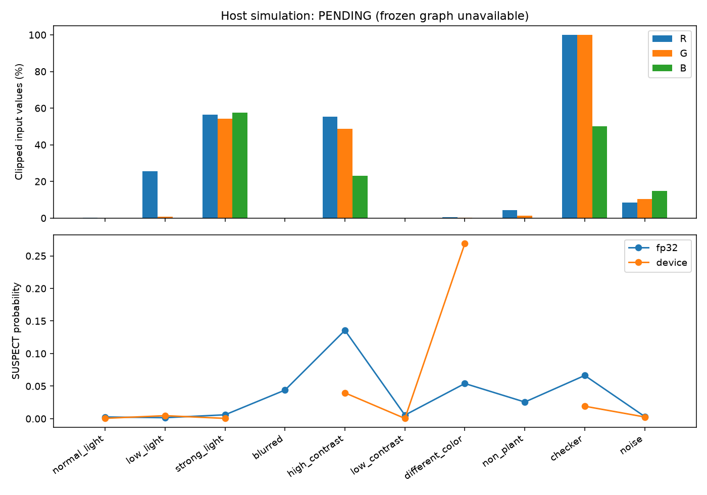

# v0.3 INT8 量化与部署差异分析

## 目的和冻结资产

比较相同 RGB 输入的 ONNX FP32、冻结 ESP-PPQ host simulation 和 ESP32 INT8，
分析输入饱和、概率差异和状态一致性。模型、量化参数和判定阈值未调整。
模型 SHA256：`bfda065ad95c3c3458d3c135b4c4b4575bdad6a31d2445b9283065d3851af3fa`。
Deployment SHA256：`f32296c1196da61aff1430481e66c9dd938db57e8d98565c926f415dc7dfc167`。
模型版本 0.1.0，设备固件 0.2.0，
输入/输出 exponent -6/-4，冻结阈值 0.30，边界 0.20/0.40。

## 环境和数据来源

本轮时间：2026-11-02T14:27:37.406112+00:00；Python 3.12.15，Windows 11，
ESP-IDF v5.4.4，ESP-DL 3.3.13。
依赖版本、基线 Git SHA、dirty 标记、分析源码 SHA 和输入 manifest SHA 记录在
[结构化数据](quantization_analysis_v03.json)。这是本地修改的开发代码，Git SHA 标识基线。

源叶片标识为 PlantVillage-7f7ecc7e-Apple-healthy，标签 NORMAL，划分 train，
原图 SHA `1a08c42d06548adfd693a2941d3cebe9582cab968e31e49d993b68acf3a6545b`。本轮选用历史训练来源作部署诊断。
七类叶片探针由同一图像进行确定性变换；颜色场景为合成通道置换，
不能当自然异色叶片的独立标注。其余为合成几何梯度、1-pixel 棋盘和 seed=303 随机噪声。
本轮未使用最终测试集调参，受控探针不构成田间准确率样本。

## 三方方法和后端状态

先核对源图 SHA，再执行同一 RGB/BILINEAR 160 预处理。FP32 和 host 使用同一归一化 NCHW；
设备收到同一 RGB888，CRC/ACK、序列号和 boot_id 绑定响应，PC 记录发送 RGB SHA。
设备不是自行回传图像 SHA。正式模型身份 13 项字段全部通过。

FP32 与真实 ESP32 已执行 10 个场景。Host 状态：**PENDING: frozen native graph and hash-bound quantization report required**。
本地没有正式 ESP-DL 对应的 frozen .native 和 simulation_graph_sha256；已安装 esp-ppq 本身不补足这些文件。
历史 host 测试分数保留为历史证据，不填入本轮逐图结果。

## 量化误差和分类一致率

| 场景 | 饱和 % | FP32 p(SUSPECT) | ESP32 p(SUSPECT) | FP32 / ESP32 状态 |
| --- | ---: | ---: | ---: | --- |
| normal_light | 0.1133 | 0.002596 | 0.000553 | NORMAL / NORMAL |
| low_light | 8.7656 | 0.001528 | 0.004610 | NORMAL / NORMAL |
| strong_light | 55.9961 | 0.005950 | 0.000458 | NORMAL / NORMAL |
| blurred | 0.0000 | 0.043905 | null | UNKNOWN / UNKNOWN |
| high_contrast | 42.4375 | 0.135649 | 0.039639 | NORMAL / NORMAL |
| low_contrast | 0.0000 | 0.005457 | 0.000404 | NORMAL / NORMAL |
| different_color | 0.1654 | 0.053997 | 0.268941 | NORMAL / UNKNOWN |
| non_plant | 1.8750 | 0.025557 | null | UNKNOWN / UNKNOWN |
| checker | 83.3333 | 0.066339 | 0.019124 | NORMAL / NORMAL |
| noise | 11.2591 | 0.003329 | 0.002632 | NORMAL / NORMAL |

门控状态一致 9/10；
质量通过且有双端概率的分母为 8，p(SUSPECT) MAE=0.046817，
最大绝对差=0.214945。blurred / non_plant 的设备质量失败，
没有执行归一化和模型；FP32 原始概率保留分析，但两端门控状态均为 UNKNOWN。
三方状态一致率：PENDING，分母 0。
FP32/host 与 host/device 统计见 JSON 对应分母。

## 饱和和场景分析

exponent=-6 的可表示反量化范围为 [-2, 1.984375]；ImageNet RGB 全范围归一化分别为
R [-2.117904,2.248908]、G [-2.035714,2.428571]、B [-1.804444,2.640000]。
按 S3 实际舍入，未截断的 uint8 范围为 R 7..240、G 2..230、B 0..217。
因此此输入刻度不能覆盖全部颜色强度；这来自冻结模型，不在本轮改变。

低光场景各通道截断为 R 25.50%、G 0.80%、B 0.00%。
棋盘总计 83.3333%，固定源图总计 0.1133%。
本组十探针总体饱和比例 P50=5.3203%、P95=71.0316%；各场景只有一个受控样本，
该分布不是农业图像总体分布。每通道归一化分位数和原始范围存于 JSON。

## 失败案例和解释

颜色通道置换从 FP32 NORMAL 变成设备 UNKNOWN，概率差 0.214945，输入饱和 0.1654%。
强光饱和 55.9961%，概率差 0.005491。饱和率不能单独预测输出误差。
Host 对照缺失，尚不能把误差分解为量化图误差与设备执行误差。
棋盘和噪声质量通过并得到 NORMAL，直接说明质量门控不判断植物存在性。
协议/执行错误样本数为 0；部署判定分歧和执行错误分别统计。

## 新摄像头计时

另外采集 10 帧实时画面，全部取得设备结果，不保存原始照片，
画面没有独立农业标注，仅用于链路与计时。整次实验 16.472 秒，
完成 FPS=0.607，包含相机启动及首帧等待。

| 阶段 | P50 ms | P95 ms |
| --- | ---: | ---: |
| pc_capture_ms | 7.740 | 484.244 |
| pc_preprocess_ms | 2.350 | 3.185 |
| transfer_ms | 255.713 | 360.256 |
| quality_us | 125.058 | 125.072 |
| preprocess_us | 96.941 | 96.952 |
| inference_us | 523.173 | 523.187 |
| serial_roundtrip_ms | 1012.163 | 1024.226 |
| end_to_end_ms | 1023.864 | 1505.052 |

采集 P95 包含首次等待；十帧样本描述当前会话，不能代表长期分布。首尾空闲内部 RAM
286447/286447 bytes、PSRAM
5046852/5046852 bytes。
v0.2 的 500 帧 / 536.46 秒、527.840/527.850 ms
设备推理记录保留在 [HARDWARE_V02.md](HARDWARE_V02.md)，两次实验分别报告。
设备推理、发送到结果和采集到结果的时钟口径不同；不通过相加边际 P50 推算总延迟。

## 结论与下一步

保持正式模型、exponent 和阈值。首先恢复原始可信 native 图，补齐相同 RGB 的 host/device
逐图对照；然后使用独立带标注真实光照/色彩叶片分析分层误差。候选校准集或 QAT 使用
独立目录和验证集比较，选定后再一次性评估最终测试集。
独立田间验证、功耗仪测试、候选量化优化为 PENDING。
性能优化优先测 USB 发送/ACK、设备质量/归一化和 PC 首帧等待；调整采样频率时继续使用
单帧在途策略，并单独运行较长时段、多场景及重连实验。
